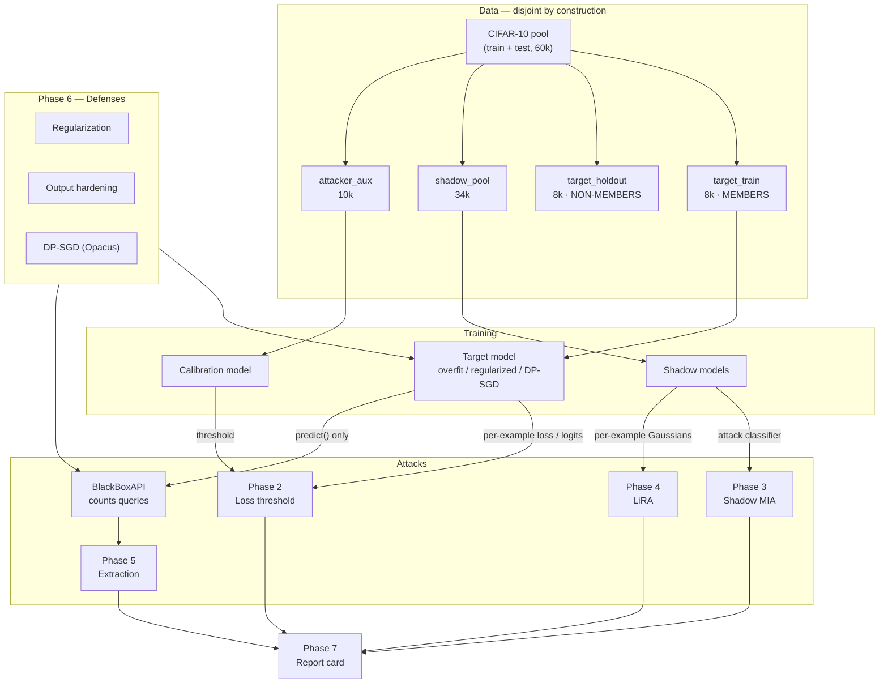

# Model Privacy Attack Lab

A research-style lab for measuring **how much a machine learning model leaks
about its training data**, and whether defenses actually fix it.

It implements membership inference attacks of increasing strength, a
black-box model extraction attack, and the defenses against both — including
DP-SGD — then evaluates everything with low-false-positive-rate metrics and
reports the privacy-vs-utility trade-off.

The opinionated part: **membership inference is never reported as accuracy
alone.** Every attack reports AUC *and* TPR at 1% and 0.1% FPR, because
privacy is a worst-case property. An attack that is 60% accurate on average
but never confident leaks far less than one that identifies 1% of the
training set with near-certainty — and only the second one shows up in
TPR@0.1%FPR.

---

## Ethics

Everything in this repository runs against **models trained by this
repository, on public datasets** (CIFAR-10, CIFAR-100, Adult Income), on the
author's own hardware or a free Colab GPU. No third-party model, hosted API,
or private dataset is targeted at any point.

The attacks exist so the defenses can be measured. A defense whose effect on
real attacks has never been measured is an assumption, not a mitigation —
which is why implementing attacks is a necessary part of defensive work.
Applying this code to a system you do not own or have explicit written
authorization to test is likely illegal and is not a supported use.

See [docs/threat_model.md](docs/threat_model.md) for the full scope.

---

## Architecture



The data-split design is the foundation: all four splits are non-overlapping
slices of **one seeded permutation**, so disjointness holds structurally
rather than by convention. If the attacker's calibration data overlapped the
evaluation set, every metric in the lab would be optimistic by an unknown
margin — the most common way a privacy evaluation quietly becomes
meaningless.

---

## Setup

```bash
python -m venv .venv
source .venv/bin/activate          # .venv\Scripts\activate on Windows
pip install -r requirements.txt
```

Runs on a free Colab GPU or on CPU. Models are kept small (a 4-conv CNN and
a 3-stage tiny ResNet) so the full sweep is feasible on free-tier hardware.

> **Compute note.** The full pipeline trains well over a hundred small models
> (8 shadow models + 16 LiRA shadows + a 27-model sweep + one model per
> defense per epsilon). That is comfortable on a GPU and impractical on CPU.
> On CPU, start with `--skip-lira --skip-shadow` and a trimmed `gap_sweep.yaml`.

---

## Running the experiments

Each phase is one command, driven entirely by a YAML config.

```bash
# Phase 1 — train the targets (deliberately leaky, and hardened)
python experiments/train_targets.py --config configs/target_overfit.yaml
python experiments/train_targets.py --config configs/target_regularized.yaml

# Phases 2-4 — all membership inference attacks + comparison table
python experiments/run_mia.py --config configs/mia_overfit.yaml
python experiments/run_mia.py --config configs/mia_regularized.yaml

# Phase 2 experiment — does overfitting cause leakage?
python experiments/run_gap_sweep.py --config configs/gap_sweep.yaml

# Phase 5 — model extraction at five query budgets, two API settings
python experiments/run_extraction.py --config configs/extraction.yaml

# Phase 6 — every defense, incl. the DP-SGD epsilon sweep
python experiments/run_defenses.py --config configs/defenses.yaml

# Phase 7 — the dashboard
streamlit run app/streamlit_app.py
```

**On a GPU:** open `notebooks/run_full_sweep_colab.ipynb` in Google Colab
(set runtime to T4 GPU). It clones the repo, installs deps, runs the test
suite as a pre-flight check, then executes every experiment above and saves
artifacts to Drive. Budget 3-4 hours. The notebook contains no lab logic —
every cell shells out to `experiments/`, so it can't drift from the library.

Tests:

```bash
pytest tests/ -q          # 85 tests, ~60s (DP tests are the slow ones)
```

### Outputs

| Path | Contents |
|---|---|
| `results/checkpoints/` | model weights |
| `results/logits/` | per-example loss / probs / logits for members & non-members |
| `results/metrics/` | per-epoch training history, attack metric bundles (JSON) |
| `results/tables/` | comparison tables (CSV) |
| `results/plots/` | ROC, trade-off, and comparison figures (PNG) |

---

## What each phase does

**Phase 1 — Foundations.** Disjoint splits; `SimpleCNN` / `SmallResNet` /
`TabularMLP`, all GroupNorm-based and Opacus-compatible from day one; a
training loop that records the generalization gap and saves per-example
statistics for later attacks.

**Phase 2 — Loss threshold.** Predict "member" if loss is low. The threshold
is calibrated on a shadow model trained on the attacker's auxiliary data —
never on the target's evaluation data. Establishes the floor.

**Phase 3 — Shadow MIA (Shokri et al.).** Train N shadow models with known
membership, build features (sorted softmax vector + loss + true-label
confidence), and train a binary attack classifier. Global and per-class
variants are both trained and compared.

**Phase 4 — LiRA (Carlini et al.), simplified.** Per-example Gaussians for
the IN and OUT hypotheses, compared by likelihood ratio, on logit-scaled
confidences. This is what buys high TPR at low FPR: an easy example whose
confidence is high whether or not it was trained on contributes no evidence,
so the attack stops wasting false positives on it.

**Phase 5 — Model extraction.** The target is wrapped in a `BlackBoxAPI` that
exposes only `predict()` and counts one query *per example* — batching can't
defeat the budget. The attacker uses out-of-distribution unlabelled data
(CIFAR-100) and a *different* architecture, which is the realistic case.

**Phase 6 — Defenses.** Regularization, output hardening, and DP-SGD at
ε ∈ {1, 3, 8, 20, ∞} with δ = 1/N. Output hardening is measured against MIA
as well as extraction, by recomputing the attacker's features through the
hardened API — scoring a label-only API against un-hardened losses would make
the defense look far stronger than it is.

**Phase 7 — Report card.** A Streamlit dashboard with a documented Low /
Medium / High risk rule.

**Uncertainty.** The MIA comparison table reports **bootstrap confidence
intervals** on AUC and TPR@0.1%FPR alongside the point estimates. Low-FPR
metrics rest on a handful of examples and swing widely — in a small pilot
run, LiRA's apparent 1.7x edge at 0.1% FPR had an interval overlapping the
baseline's almost entirely. Without intervals that gap reads as a result;
with them it reads as noise. Note these cover *evaluation* uncertainty only;
training-run variance needs multiple seeds (`summarize_over_seeds`).

---

## Results

> **These are CPU-pilot results, not the full lab.** The machine this was run on has no GPU, and the full
> pipeline trains well over a hundred models. What was actually run is a **scaled-down** version (2,000
> training members instead of 8,000, 30 epochs instead of 60, one seed) of the **loss-threshold attack
> only**, plus a 4-model generalization-gap sweep. **Not run:** shadow-model MIA, LiRA, model extraction,
> and every defense including DP-SGD. Configs: `configs/*_cpu.yaml`. Raw outputs: `results/`. The
> full-size experiments above remain the GPU path.

### Loss-threshold membership inference (2,000 members vs 2,000 non-members)

| target | train acc | test acc | gap | AUC [95% CI] | TPR @ 1% FPR | TPR @ 0.1% FPR [95% CI] | balanced acc |
|---|---|---|---|---|---|---|---|
| overfit (no regularisation, 30 epochs) | 100% | 50.3% | 0.497 | **0.869** [0.855, 0.881] | 1.3% | 0.2% [0.0, 0.45] | 86.8% |
| regularised (dropout 0.3, wd 5e-4, early stop at 14 epochs) | 87.2% | 48.3% | 0.390 | **0.686** [0.670, 0.702] | 1.65% | 0.2% [0.05, 0.55] | 65.3% |

Two things stand out:

- **A high-AUC attack can be nearly useless at low false-positive rates.** Against the overfit model the
  attack separates members from non-members well on average (AUC 0.87, 87% balanced accuracy) yet at a 0.1%
  FPR it identifies only 0.2% of members, barely above the 0.1% a coin flip would give. This is precisely
  the lab's methodological point: reporting AUC or accuracy alone would have called this attack strong.
- **Regularisation cut average-case leakage** (AUC 0.87 to 0.69) **but the low-FPR number did not
  change measurably** (0.2% for both; the intervals overlap). I can not conclude that worst-case leakage
  survived regularisation, because this attack cannot see worst-case leakage in *either* model; that
  question needs LiRA, which was not run.

### Generalization gap versus attack success (4 models, one seed each, no error bars)

| epochs | training size | gap | AUC | TPR @ 1% FPR | TPR @ 0.1% FPR |
|---|---|---|---|---|---|
| 5 | 500 | 0.038 | 0.576 | 4.0% | 0.6% |
| 5 | 1,500 | 0.124 | 0.603 | 1.5% | 0.2% |
| 15 | 500 | 0.472 | 0.815 | 8.4% | 4.6% |
| 15 | 1,500 | 0.493 | 0.816 | 2.9% | 0.5% |

AUC rises monotonically with the gap (0.58, 0.60, 0.82, 0.82). The last two rows have the same AUC but a
ten-fold different TPR at 0.1% FPR (4.6% versus 0.5%): smaller training sets leak more of their worst-case
members at the same average-case AUC. **Caution:** at 0.1% FPR the threshold is set by one or two
non-members, so low-FPR figures here are very noisy; with one seed this is a direction, not a measurement.

## Key findings

Status of the five hypotheses this lab was built to test, after the CPU pilot:

1. **Attack strength ordering shows up at low FPR, not in AUC.** *Not testable yet.* It needs the shadow
   and LiRA attacks. (The pilot does show the underlying point for a single attack: AUC 0.87, TPR@0.1%FPR 0.2%.)
2. **Overfitting drives average-case leakage.** *Supported directionally:* AUC 0.58 to 0.82 as the gap
   grows from 0.04 to 0.49. Four points, one seed.
3. **A small gap is not safety.** *Inconclusive.* The regularised model's gap was still large (0.39), and
   the attack used cannot resolve worst-case leakage.
4. **Full probability vectors are worth a lot to an extraction attacker.** *Not run.*
5. **DP-SGD is the only defense that bounds worst-case leakage.** *Not run.*

### Running the pilot, and a Windows pitfall

```bash
python experiments/train_targets.py --config configs/target_overfit_cpu.yaml
python experiments/train_targets.py --config configs/target_regularized_cpu.yaml
python experiments/run_mia.py --config configs/mia_overfit_cpu.yaml --skip-lira --skip-shadow
python experiments/run_mia.py --config configs/mia_regularized_cpu.yaml --skip-lira --skip-shadow
python experiments/run_gap_sweep.py --config configs/gap_sweep_cpu_pilot.yaml      # ~3 min
```

About 25 minutes in total on a 16-core CPU (roughly 27 s per epoch at the full 8,000-member size).
**Windows:** `configs/base.yaml` sets `num_workers: 2`. With PyTorch's `spawn` start method that
re-launches two worker processes for each of the two data loaders every epoch, and runs stalled for over
an hour in testing. The `*_cpu.yaml` configs set `num_workers: 0`; do the same for any CPU run on Windows.

## Limitations

Stated plainly, because a privacy result without its caveats is misleading.

- **LiRA is simplified.** The paper trains 256 shadow models; this trains
  8-32, and omits query augmentation. Reported TPR is therefore a **lower
  bound** on LiRA's true power, not a reproduction of the paper.
- **Small models, one dataset.** A 4-conv CNN on CIFAR-10 is not a modern
  architecture on a realistic dataset. Leakage behavior does not necessarily
  transfer to large models, pretrained backbones, or non-image data. The
  Adult Income path (`TabularMLP`) exists but is not yet exercised end-to-end.
- **Attacks are lower bounds, defenses are not upper bounds.** "Attack X got
  2% TPR" means leakage is *at least* that. Only DP-SGD's ε provides an
  actual upper bound. A **LOW** risk label in the dashboard means "these
  particular attacks did not succeed", never "this model is safe".
- **Shadow counts are small**, so per-example variance estimates are noisy;
  LiRA defaults to a pooled global variance for that reason.
- **Strong attacker assumptions for MIA**: architecture and training recipe
  are assumed known. A real attacker who guesses wrong does worse.
- **Risk thresholds are judgement calls** for a teaching lab, not an industry
  standard.
- **Not a compliance tool.** No mapping to GDPR/HIPAA/CCPA obligations.

---

## Future work

- Run the full sweep on GPU and populate the Results section with real numbers
- Multi-seed error bars across *all* attacks (bootstrap CIs cover evaluation
  noise today; seed variance still needs multiple training runs)
- Full LiRA: 128+ shadows with query augmentation, plus the offline variant
- Label-only MIA via decision-boundary distance (stronger than the
  correctness baseline used under hardening)
- The Adult Income tabular pipeline end-to-end, to test whether findings
  transfer off images
- DP-SGD with a pretrained backbone, where the accuracy cost is known to be
  much smaller
- Attribute/property inference; model inversion

---

## Repository layout

```
configs/          YAML experiment configs (base.yaml + one per experiment)
src/
  data.py         CIFAR-10/100 loading, disjoint splits, in/out draws
  models.py       SimpleCNN, SmallResNet, TabularMLP (all DP-compatible)
  train.py        standard + DP-SGD training, per-example stat extraction
  metrics.py      AUC, TPR@low-FPR, balanced accuracy, fidelity
  defenses.py     output hardening, Opacus wrappers
  plots.py        publication-style figures (validated colorblind-safe palette)
  utils.py        seeding, config loading, artifact I/O
  attacks/
    loss_threshold.py   Phase 2
    shadow_mia.py       Phase 3
    lira.py             Phase 4
    extraction.py       Phase 5 (BlackBoxAPI lives here)
experiments/      thin CLI runners; all logic lives in src/
notebooks/        Colab notebook for the full GPU sweep (calls experiments/ only)
app/              Streamlit Privacy Report Card
tests/            85 tests: splits, metrics, attacks, API accounting, DP, e2e
docs/             threat_model.md
results/          generated artifacts
```

## References

- Shokri et al., *Membership Inference Attacks Against Machine Learning Models*, IEEE S&P 2017
- Yeom et al., *Privacy Risk in Machine Learning*, CSF 2018
- Carlini et al., *Membership Inference Attacks From First Principles*, IEEE S&P 2022
- Tramèr et al., *Stealing Machine Learning Models via Prediction APIs*, USENIX Security 2016
- Abadi et al., *Deep Learning with Differential Privacy*, CCS 2016
